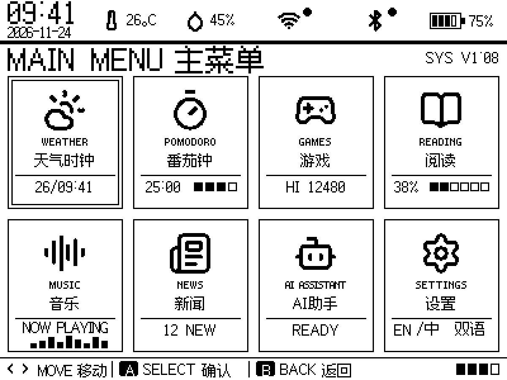
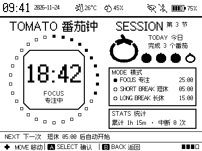
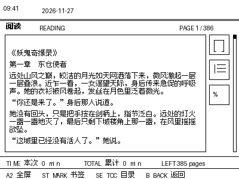
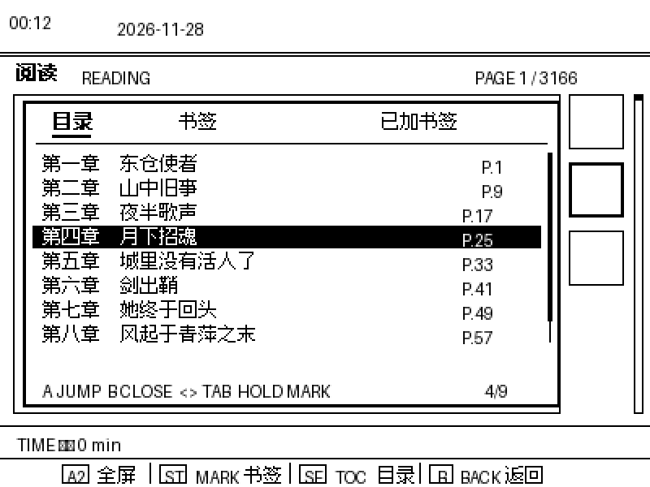
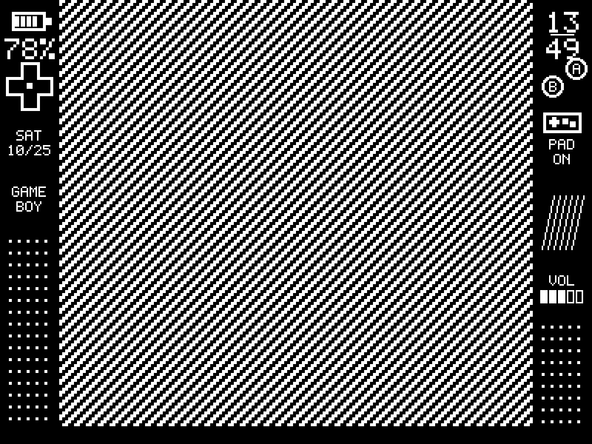
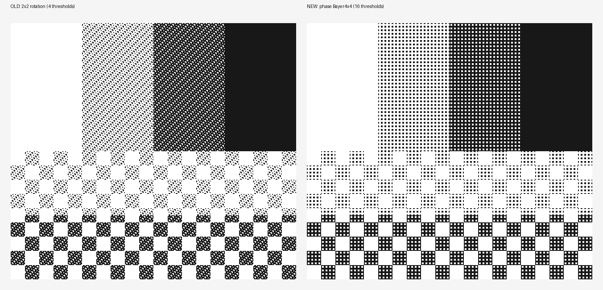
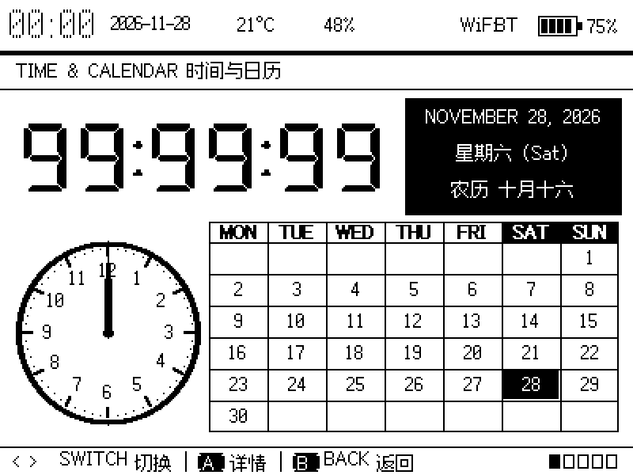
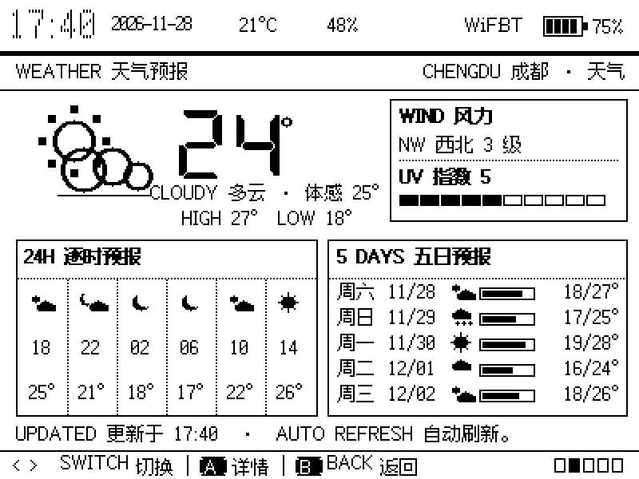

# ESP32-S3 RLCD 4.2 天气时钟 · 游戏版

> **简体中文（当前）** · [English](README_EN.md) · [繁體中文](README_zh_TW.md) · [日本語](README_JA.md)

这是一个基于 **ESP32-S3** 和 **4.2 英寸 RLCD 屏幕** 的低功耗天气时钟固件。它在常驻显示、本地温湿度、联网天气、日历、图片展示、音频提醒和 OTA 更新之外，新增了**第六个工作页「游戏」**，让这块单色墨水屏能直接玩 Game Boy 游戏。

## 关于本分支

本项目是 [`wickenzh/ESP32-S3-RLCD-4.2`](https://github.com/wickenzh/ESP32-S3-RLCD-4.2) 的分支。原始项目由 **wickenzh** 开发并维护，版权与许可归原作者所有，本分支完整保留其署名、许可证和上游链接。所有原创部分的非商业使用限制继续适用，详见 [`LICENSE`](LICENSE)。

本分支相对上游做了这几件事：

**新增卡片式主菜单作为主页。** 开机先进主菜单，8 张卡片（天气时钟、番茄钟、游戏、阅读、音乐、新闻、AI 助手、设置）以两排四列呈现，顶部状态栏显示日期时间、温湿度、WiFi、蓝牙和电量。支持实体键和蓝牙手柄操作，详见下方「主菜单」。

**番茄钟工作页可用。** 经典 25/5/15 分钟节奏，倒计时按秒局刷，四节专注后进长休；SESSION 随阶段递增，今日番茄数与累计专注写入 NVS 断电保留。主菜单的番茄钟卡片直接显示当前模式时长与今日完成方块，详见下方「番茄钟工作页」。

**新增 Game Boy 模拟器工作页。** 用 Peanut-GB 内核配 minigb_apu 出声，ROM 从 TF 卡读取，支持蓝牙手柄、电池存档和 4 级灰度模拟。详情页见下方「游戏工作页」。

**新增阅读工作页。** TF 卡上的 TXT 自动识别 UTF-8 / UTF-16 / GBK，按 400×300 重新分页，12px 中文点阵字库放卡上运行时载入；带章节目录、8 个书签、全屏阅读和最近阅读排序。详情见下方「阅读工作页」。

**天气时钟工作页重做。** 上游八个工作页精简为天气时钟和游戏两个，天气时钟内含「时间与日历」和「天气预报」两个子页。大字时间使用 DSEG7 七段字模，按真实墨迹居中并支持秒级局部刷新；天气页接入 Open-Meteo 的体感、逐小时、最高最低温、风力和 UV 数据，默认城市为四川成都。中文直接复用 TF 卡上的 19450 字 Fusion Pixel 字库，不再受固件内置子集缺字限制。

**裁掉一批模块给 app 分区腾空间。** 移除小智 AI 语音助手的运行时代码（`main/xiaozhi/` 及其 UI、模拟器预览、测试）、`weather_city_mcp`、固件发布工作流 `build-release.yml` 和三个网页构建脚本。app 分区上限 6MB，加入模拟器和主菜单后已用到约 96%，不裁剪放不下。主菜单里 AI 助手卡片为占位，暂未接入功能。

上游其它能力（八个页面中的七个、天气、OTA、配网页、上位机、Power Demo）保持原样。当前版本为 **v1.3**，更新记录见 [Releases](https://github.com/leosongyyy/ESP32-S3-RLCD-4.2-WeatherClock-Studio/releases)。

## 快速入口

**界面主要基于 LVGL 开发。** 页面布局、文字、菜单和状态控件由 LVGL 管理；大号时钟、图片和曲线等通过 LVGL Canvas 与自定义绘制实现。底层 RLCD 驱动负责单色输出，并优先采用局部刷新，兼顾显示效果与低功耗。

- [简易用户手册](docs/User_zh.md) · [用户详细说明](docs/User_Detailed_zh.md)
- [贡献指南 / Contributing Guide](CONTRIBUTING.md)
- [安全政策 / Security Policy](SECURITY.md)
- [第三方开源许可说明](THIRD_PARTY_NOTICES.md)
- [项目许可证](LICENSE)
- [最低功耗 Power Demo](docs/Power%20Demo/README.md)
- [实机模拟预览](https://wickenzh.github.io/ESP32-S3-RLCD-4.2/#screens)

### 主菜单界面



两排四列卡片、顶部状态栏与底部按键提示栏。图片由 `RLCD_CLOCK/tests/mainmenu_preview.py` 从同一套点阵和字体生成，与固件显示一致；未接入功能的卡片处于占位状态。

## 关联项目

- [微雪 ESP32-S3-RLCD-4.2 官方产品页](https://www.waveshare.com/product/esp32-s3-rlcd-4.2.htm)：本项目所使用开发板的官方介绍、规格和购买信息。
- [微雪 ESP32-S3-RLCD-4.2 官方文档](https://docs.waveshare.com/ESP32-S3-RLCD-4.2)：开发板接口、原理图、示例和硬件资料。
- [ESP32-S3-RLCD-4.2_UP](https://github.com/wickenzh/ESP32-S3-RLCD-4.2_UP)：OTA 固件镜像仓库，可查看可用固件及版本信息。
- [在线上位机](https://wickenzh.github.io/ESP32-S3-RLCD-4.2/)：配置资源、转换图片/GIF、校验并烧录固件、查看串口日志；[源码与说明](host_web/README.md)。

## 主菜单

这是本分支新增的开机主页，采用 400×300 单色画布绘制，两排四列共 8 张卡片。选中卡片用双线内框加粗高亮。

| 卡片 | 说明 |
|---|---|
| 天气时钟 / 番茄钟 / 游戏 / 阅读 | 已进入对应工作页，番茄钟与游戏页见下节 |
| 音乐 / 新闻 / AI 助手 | 占位卡片，暂未接入功能，选中后留在主页 |
| 设置 | 进入设置页，可开关页面、排序、配网等 |

天气时钟卡片的下方一行显示当天星期（周一到周日），当天如逢二十四节气则追加节气名，例如「周三 春分」。跨天自动更新，不走全屏刷新。

游戏页和设置页只能从主菜单进入。在天气时钟及其余工作页用左右方向键或长按切换页面时，会自动跳过游戏页，不会误入。

顶部状态栏左边是日期和时间（同一行，时间用大号字），右边依次是温度、湿度、WiFi、蓝牙和电量。温湿度读板载传感器；WiFi 和蓝牙各用连接 / 断开两种图标直接显示状态；蓝牙开启时会自动回连已配对的 BLE 手柄。底部是按键提示栏，显示十字键 + MOVE 移动、A 选择确认、B 返回。

### 实体键操作

| 场景 | 操作 | 效果 |
|---|---|---|
| 主菜单 | BOOT 单击 | 右移一格，行优先循环（第一排末尾进第二排，末尾回第一格） |
| 主菜单 | KEY 单击 | 左移一格，反向循环 |
| 主菜单 | BOOT 双击 | 进手柄绑定页 |
| 主菜单 | KEY 双击 | 进入当前选中模块 |
| 主菜单 | BOOT + KEY 同按 | 从任意页面回主菜单 |
| 主菜单 | 手柄十字键 | 上下左右移动焦点（边沿触发，不连发） |
| 主菜单 | 手柄 A / B | 进入当前选中模块 |

单击要等双击窗口过去才结算，避免和双击语义抢键。

### 手柄全局导航

除了游戏运行页，手柄在所有页面通用，语义如下：

| 手柄按键 | 效果 |
|---|---|
| LB + RB 同按 | 回主菜单（最高优先级，所有非游戏运行页生效） |
| 上 / 下 | 移动选单（设置页移焦点，其它页切工作页），按住连发 |
| 左 / 右 短按 | 移动选单（同上） |
| 左 / 右 长按 | 切换工作页（右=下一页，左=上一页） |
| A | 确认（等同实体 KEY 短按） |
| B | 返回（等同实体 BOOT 短按） |

设置页里手柄 A 为确认、B 为返回，操作即时响应，不会和页面切换抢键。

游戏 ROM 列表页沿用专门的一套操作，见下节。

## 番茄钟工作页

这是本分支新增的可用工页，采用经典番茄工作法节奏，倒计时按秒局部刷新，电子纸只在数字变化时更新，不会整秒闪烁。

### 节奏与流转

| 阶段 | 时长 | 说明 |
|---|---|---|
| 专注 FOCUS | 25 分钟 | 一轮连续完成 4 节专注 |
| 短休 SHORT BREAK | 5 分钟 | 每完成一节专注后进入 |
| 长休 LONG BREAK | 15 分钟 | 完成第 4 节专注后进入，之后回到专注 |

一节专注或休息到点后自动进入下一阶段并立即开始计时。界面上的 SESSION 显示第几节，手动切换 MODE 或自动流转都会让节数加一。今日完成番茄数、累计专注时长和中断次数写入 NVS，断电保留，跨天自动清零当日番茄数。

双击重置会把计时回到专注第 1 节的 25:00 并进入空闲，今日番茄数、累计专注和中断次数这些统计不清零。

### 操作

| 场景 | 操作 | 效果 |
|---|---|---|
| 番茄钟 | 手柄 A / 物理 BOOT 单击 | 开始 / 暂停当前阶段 |
| 番茄钟 | 手柄 A 双击 / 物理 KEY 双击 | 重置到专注第 1 节 |
| 番茄钟 | 手柄上 / 下 / 左 / 右 | 循环切换 MODE |
| 番茄钟 | 物理 BOOT 双击 | 从上到下循环切 MODE（专注→短休→长休→专注） |
| 番茄钟 | 手柄 B / 物理 KEY 单击 | 返回主菜单 |
| 番茄钟 | 手柄 LB + RB | 回主菜单 |

单击要等双击窗口过去才结算，避免和双击重置抢键。



### 主菜单同步

主菜单的番茄钟卡片实时显示当前模式时长（25:00 / 05:00 / 15:00），下方最多 4 个实心方块代表当天已完成的番茄数，每完成一节专注多亮一格。数据和番茄钟工作页共享同一份 NVS 状态，进出一页后另一页立即同步。

## 阅读工作页

主菜单选「READING 阅读」进入。书库与正文共用一张 400x300 canvas，整屏直写像素 + 精确局刷。



正文、右栏三键与底栏由 `RLCD_CLOCK/tests/reading_preview.py` 用同一套卡上字库离线渲染，排版口径与固件一致（内容宽 320px、行距 13px、段尾加 6px）。

**书库**一屏 6 本（2 列 3 行），左右越界自动翻页书架，题头右侧显示总本数与打开失败的提示。列表按最近阅读排序，刚看过的永远排在第一本，从没打开过的按文件名跟在后面。

**正文**每行约 26 个全角字，每页最多 12 行（按行高与段距动态排版），顶栏显示 `PAGE 当前 / 总页`，右栏是书签、目录、进度百分比三键和一条竖进度条，底栏显示本次阅读时长、累计时长和剩余页数。

**目录**在打开书时按行扫描章节标题（`第X章/节/回/卷`、`卷一`、`序章`、`楔子`、`Chapter N` 等），最多记 600 条；没有识别到标题的纯文本会提示「未识别到章节标题」。
**书签**每本最多 8 个，按页号升序存进 NVS，书签页图标会变实心。没有手柄时在弹层里长按 BOOT 就能加，目录页签下加的是当前阅读页，书签页签下删的是选中那一条。

**全屏阅读**：手柄在正文里 350ms 内连按两次 A，或不接手柄时按住 BOOT 800ms（弹层关着）切换。全屏时状态栏、题头、右栏、底栏全部不画，正文按 376px 宽、21 行重新分页，同样的字号一屏多看将近一倍的字；退出全屏原样回到刚才那一页（用字节锚点接回，不受页数变化影响）。



目录与书签共用一个弹层，左右切页签、上下选条目，A 跳转、B 关闭；条目右侧是页码，长目录带滚动条。

操作：

| 按键 | 书库 | 正文 | 目录/书签弹层 |
|---|---|---|---|
| 方向键 / 手柄十字键 | 移动选中格，左右越界翻页 | 左右/上下翻页 | 上下选条目，左右切页签 |
| A 单击（手柄） | 打开选中的书 | — | 跳到选中条目 |
| A 双击（手柄，350ms 内） | — | 切换全屏 | — |
| BOOT 单击（实体键） | 打开选中的书 | 下一页 | 关闭弹层 |
| BOOT 双击（实体键，350ms 内） | — | 上一页 | 关闭弹层 |
| BOOT 长按（800ms） | — | 切换全屏 | 加/删书签 |
| B / KEY 单击 | 回主菜单 | 回书库 | 关闭弹层 |
| SELECT / KEY 双击 | — | 打开目录弹层 | 关闭弹层 |
| START | — | 当前页加/删书签 | 当前页加/删书签 |
| LB+RB | 回主菜单 | 回主菜单 | 回主菜单 |

不接手柄也能全程操作：弹层里长按 BOOT 就是加书签的入口，目录页签下加的是当前阅读页，书签页签下删的是选中那一条。BOOT 的单击要等 350ms 双击窗口过去才执行，所以翻页比手柄按一下略慢；这是把「单击 / 双击 / 长按」压在一个键上必须付的代价。

数据与资源目录（都在 TF 卡上，固件不内置书库内容）：

```
/sdcard/book/*.txt      正文，UTF-8 / UTF-16(BOM) / GB2312-GBK 自动识别
/sdcard/book/*.epub     暂只列进书库，打开时提示不支持
/sdcard/font/fusion_pixel_12.bin   正文用 12px 中文字库
```

- `book/` 为空时固件会写一本内置的古文样例，保证首次进入有内容可看。
- 阅读进度与累计时长按文件名哈希存 NVS（namespace `reading`），换书不丢。
- 进度同时存页号和「本页首行的字节偏移」两份，切全屏或换字库后页数变了也能回到原处。
- 单本上限 2MB，GBK 转 UTF-8 后最大约 3MB，全部在 PSRAM 里排版。

**字体**：正文、书名、按钮中文统一用 Fusion Pixel 12px，与主菜单卡片上的模块名同一套取模字形。全 CJK 取模约 640KB，放不进 6MB app 分区，所以放在 TF 卡上运行时载入。文件缺失或校验失败时自动回退内置 `zh_font_16`（16px，每页 9 行），不影响使用。

生成字库（需要 Fusion Pixel 12px TTF，许可 OFL-1.1）：

```bash
python3 RLCD_CLOCK/tools/gen_sd_font.py \
    --ttf /path/to/fusion-pixel-12px-zh_hans.ttf \
    -o sd-assets/font/fusion_pixel_12.bin
```

生成产物同时放在仓库 `sd-assets/font/fusion_pixel_12.bin`，拷到卡上 `/sdcard/font/` 即可。ASCII 不进卡上字库，固件用内置 `fusion_pixel_12`，中英文保持同一套字形。

`RLCD_CLOCK/tests/reading_preview.py` 可以用同一份字库离线渲染一页，检查排版密度与字形；
`RLCD_CLOCK/tests/reading_panel_preview.py` 用来预览目录弹层和正文底栏的版式。

## 游戏工作页

这是本分支新增的部分。

### 放 ROM

ROM 从 **TF 卡（microSD）** 读取，路径是卡根目录下的 `rom/gb`（设备内挂载点为 `/sdcard`，首次进入游戏页会自动建目录）。

- 卡需要格式化成 FAT32。
- 最多 64 个 ROM，单个 ROM 上限 4MB，文件名支持中文（UTF-8）。
- 也可以不开壳：进配网页后在同一局域网用浏览器上传，设备提供三个接口 `/roms/list`、`/roms/upload?name=xxx.gb`、`/roms/delete?name=xxx.gb`；单次上传上限 1300 KiB（约 1.27MB）。
- 没插卡时游戏页会显示「请插入 TF 卡」。

### 操作

| 场景 | 操作 | 效果 |
|---|---|---|
| ROM 列表 | BOOT 短按 | 在 4 行 ROM 与音量条之间循环移动焦点 |
| ROM 列表 | KEY 短按 | 焦点在 ROM 上开始游戏，焦点在音量条上加一档 |
| ROM 列表 | 手柄 上/下 | 移动焦点 |
| ROM 列表 | 手柄 A 或 B | 同 KEY 短按 |
| ROM 列表 | 手柄 左/右 | 音量减/加一档（快捷键，焦点自动跳到音量条） |
| 游戏中 | 两个实体键 | 同按 600ms 暂停，按住 2s 退出 |
| 游戏中 | 手柄 | A/B/十字键/START/SELECT 直接对应 |
| 游戏中 | 手柄 LB+RB | 回主菜单 |
| 主菜单 | BOOT 双击 | 进手柄绑定页 |
| 工作页 | BOOT 长按 / KEY 长按 | 翻页 / 进设置 |

画面是 160×144 整数放大 2 倍到 320×288，居中显示，左右各留 40px 黑边。两侧留给机身风格的侧栏，显示电量、时间、日期、手柄状态和音量。



### 4 级灰度

Game Boy 原机是 4 级灰度，而这块面板只有纯黑纯白两色，必须靠**空间抖动**用面积换灰度。

墨水屏**不能做时间抖动**（逐帧交替图案）。整屏刷新要几百毫秒到一秒以上，游戏帧率只有个位数，交替图案只会变成缓慢刺眼的闪烁，还会成倍放大残影。所以图案每帧固定，只取空间维度。

放大倍率固定 2 倍，于是每个 Game Boy 像素恰好对应面板上 2×2 四个物理像素，用「点亮其中几个」表示 4 档明暗。密度按 DMG 真实调色板 `#9bbc0f / #8bac0f / #306230 / #0f380f` 的相对亮度取 `{4, 3, 1, 0}`，不是均分的 `{4, 3, 2, 1}`：机身两个亮色挨得很近、两个暗色分得开，均分会把亮部差异凭空放大一倍，画面整体偏高对比，丢掉原本的柔和层次。



左侧是 2×2 空间 PWM（默认），右侧是 4×4 Bayer 有序抖动。另有一个 4×4 Bayer 有序抖动模式可切换（在 160×144 原生分辨率上抖动再最近邻放大），纹理更细但孤立像素的灰度会丢失。默认用 2×2 空间 PWM，像素画保真度更高。两种模式都不增加帧缓冲和 SPI 开销。

### 蓝牙手柄

设备跑 **NimBLE Central**，直连市面上的 BLE 手柄，不再需要逐个按键对号入座。

- 内置 HID 1.11 报告描述符解析器，从 Report Map 直接推出按键、摇杆、Hat 的位偏移，比猜字节布局可靠。
- Hat 开关做**运行时自校准**，以观测值的众数作为静止中位。这条绕开了厂商常见的「描述符声明 0=上、固件实际发 0=中位」不一致。观测到超过 9 个不同取值就判定不是真 Hat，直接关掉方向键，而不是退化成摇杆去误判。校准出的中位按设备存进 NVS，下次连同一手柄直接恢复，不必每次重新校准。
- 手动绑定页要求**连续按三次同一个键**才确认，防串键；绑定时只接受描述符里 BUTTON/HAT 类型的字节，摇杆和常量字段一律跳过。
- 蓝牙开启后自动扫描并回连已配对手柄。手柄服务在所有页面常驻，切页不会断连；只有当手柄离线满 5 分钟后才自动关闭以省电。在主菜单双击 BOOT 进手柄绑定页会重新拉起蓝牙，方便随时回连。

如果手柄按钮出现错乱，先重启设备一次。绑定表和 Hat 校准锚点都存在 NVS 里，断电保留；报告布局锁只在内存里，断电重来。

### 存档与音量

- **存档**：卡带 RAM 落盘为 `<rom名>.sav`，写 RAM 时只有值真的变了才置脏，在暂停和退出游戏时写入，启动时读回。不暂停直接断电会丢上次落盘之后的进度，这是电池存档的固有行为。
- **音量**：ROM 列表页底部一行音量条，静音 + 5 档（20/40/60/80/100），默认 80%，存 NVS 断电不丢。ROM 列表从 5 行缩到 4 行给它腾位置。音量只能在游戏外调，下一次启动游戏才生效。

## 工作页面

本分支只保留两个工作页，**天气时钟**和**游戏**。天气时钟是配网、低电量和离线时的兜底页面，始终启用；游戏页从主菜单进入，导航时不会被误切进去。升级时旧页面掩码会按新编号迁移，无需恢复出厂。

天气时钟有两个子页，短按手柄左右切换，长按左右仍切换工作页。

- **时间与日历**：DSEG7 七段大字时分秒、月份日期卡、星期与农历、模拟表盘和当月月历。秒针和大字秒数按秒局部刷新，不整屏闪动。
- **天气预报**：当前天气与体感温度、最高最低、风力与 UV、24 小时逐时预报和五天预报，数据来自联网天气缓存；未联网时显示占位符。

两页都采用「能局部刷新就不全屏刷新」的原则，隐藏页面不会继续执行无意义的绘制。

下面是两个子页的界面预览（由固件同一套点阵字库生成的 400×300 单色图，天气为成都样例数据）。

| 时间与日历 | 天气预报 |
|:---:|:---:|
|  |  |

## 项目定位

这个项目面向长期摆放使用的桌面天气时钟。设计重点不是追求持续联网或高刷新率，而是在信息始终可读的前提下，让 Wi-Fi、音频、蓝牙、高频 UI 和其它高功耗资源只在真正需要时运行。

主要目标：

- **常驻显示**：RLCD 在不持续刷新的情况下保持画面可读。
- **按需功耗**：页面不可见时停止其专属刷新，普通联网任务完成后关闭 Wi-Fi。
- **离线可用**：支持 RTC 保持时间，也可以不配置网络直接进入离线模式。
- **稳定优先**：OTA、音频、显示、蓝牙和网络任务之间设有资源与状态保护。
- **便于维护**：页面、天气、配置、音频、传感器、OTA 和游戏按职责维护。

## 配置与联网

天气服务可选和风天气或 Open-Meteo，配网页和网页快捷配置中的开关默认关闭。开启 Open-Meteo 无需和风 Key/Host，显示 US AQI，不提供本项目预警；两个来源不自动混用。公共服务仅限非商业使用，数据来自 [Open-Meteo](https://open-meteo.com/) / [CAMS](https://atmosphere.copernicus.eu/)，城市查询使用 [GeoNames](https://www.geonames.org/)。

首次使用通过设备配网页完成配置：

- 支持主 Wi-Fi 和可选备用 Wi-Fi；主网络连续不可用时会尝试备用网络，成功后可按既有策略晋升。
- 联网天气需要 QWeather API Key 和账号专属 API Host；API Host 在 QWeather 控制台中查看。
- 天气城市可以通过配网页或上位机设置手动城市；没有手动配置时默认使用四川成都，不再按公网 IP 自动定位。
- 不配置 Wi-Fi 时，可以填写本地日期时间并进入离线模式。
- 同一个配网页提供 ROM 上传入口，见「游戏工作页」。

设备联网行为按需执行：

- 天气时钟使用同一份天气缓存，在需要时按整点及缺数据补拉规则同步；开机错峰预取。
- 每日文字在需要时单独获取。
- NTP 在启动、手动同步和既定校时点运行。
- OTA、网络检测和手动同步只在用户主动操作时运行。
- 蓝牙手柄服务在所有页面保活，手柄离线满 5 分钟后自动关闭；主菜单双击 BOOT 进绑定页会重新拉起。
- 离线模式、低电量、配网和 OTA 期间会拦截不合适的后台联网任务。

天气与每日文字使用本地缓存。短时网络失败不会清空已有内容，后台重试受次数和退避限制，避免 Wi-Fi 反复上电。

## 提醒与交互

- 两个实体按键用于页面切换、菜单移动、确认、返回和停止提示音。
- 支持整点提醒、全天提醒和多档音量设置。
- 闹钟与番茄钟使用独立状态，并对相同触发时刻进行冲突保护。
- 番茄钟工作页可用，支持开始暂停、手动切 MODE、双击重置和跨天统计；语音控制的入口随小智 AI 一起移除。

## 低功耗策略

固件在不改变屏幕常驻显示的前提下减少无效工作：

- 启用 ESP-IDF 动态电源管理与 FreeRTOS Tickless Idle：CPU 在负载允许时从 `240MHz` 自动降至 `40MHz`，空闲窗口自动进入 Light Sleep；联网、音频和 OTA 只在工作期间通过 PM Lock 临时保持所需性能。
- 秒级页面采用局部刷新；静态页面在没有事件时暂停周期绘制。
- 温湿度、电池和历史采样按运行时段及充电状态调度。
- 普通天气、每日文字、NTP 和 OTA 会错峰执行，避免启动阶段集中占用内存与 Wi-Fi。
- 音频播放结束后释放 Codec 和相关资源；游戏音频只在游戏页运行，音频采样率固定 32kHz。
- 蓝牙在所有页面保活，手柄离线满 5 分钟后自动关闭；在主菜单双击 BOOT 进绑定页会重新拉起，兼顾随时可连与长时间离线的省电。
- TF 卡只在进入游戏页或上传 ROM 时访问。
- Wi-Fi 图标与无线电实际状态保持一致，便于直接观察高功耗网络是否仍在运行。
- OTA 下载期间降低 UI 刷新频率，并保留百分比、速度和进度条。
- 低电量模式会进入极简显示并禁止高功耗操作。

`docs/Power Demo/` 中的 [Power Demo](docs/Power%20Demo/README.md) 是独立实验工程，用于验证保留屏幕显示、分钟级唤醒和最小外设条件下的功耗边界。它不包含完整版设置、OTA、多页面和游戏业务，也不参与正式固件构建。

## 硬件与软件

- 开发板：[Waveshare ESP32-S3-RLCD-4.2](https://www.waveshare.com/product/esp32-s3-rlcd-4.2.htm)。
- 主控：ESP32-S3-WROOM-1-N16R8，16MB Flash、8MB PSRAM（Octal 80MHz）。
- 显示：4.2 英寸 400 × 300 RLCD，单色 1bpp。
- 存储：板载 TF（microSD）卡槽，SDMMC 1-bit 模式；另有 NVS 保存联网与用户设置，独立资源分区保存可更新素材。
- 本地设备：RTC、温湿度传感器、电池 ADC 和实体按键。
- 音频：ES8311 Codec、功放、扬声器和麦克风，用于提示音与游戏音频。
- 网络：Wi-Fi（配网、天气、每日文字、NTP、OTA、ROM 上传）与 Bluetooth LE（NimBLE Central/Observer，最多 1 路连接）。
- 开发框架：ESP-IDF `v5.5.3`；图形界面：LVGL `v8.4.0`；音频编解码：`esp_audio_codec` `v2.4.1`。

## 源码结构

- `RLCD_CLOCK/main/`：应用入口和按业务划分的固件模块。
  - `main/ui/ui_main_menu.cpp`、`main/ui/ui_main_menu.h`：卡片式主菜单（状态栏、8 张卡片、底栏），canvas 直写像素 + 精确局部刷新，番茄钟卡片与天气钟星期节气同步。
  - `main/ui/ui_pomodoro.cpp`、`main/ui/ui_pomodoro.h`：番茄钟工作页绘制与局部刷新。
  - `main/pomodoro/pomodoro_classic.cpp`、`main/pomodoro/pomodoro_classic.h`：番茄钟计时核心、阶段流转与 NVS 统计。
  - `main/ui/calendar_lunar.cpp`、`main/ui/calendar_lunar.h`：农历与节气查询，供天气钟卡片显示当天节气。
  - `main/ui/ui_game.cpp`、`main/ui/ui_game_bind.cpp`：游戏页与绑定页。
  - `main/input/input_tasks.cpp`：实体键与手柄输入，含主菜单按键语义、全局手柄导航、LB/RB 肩键、番茄钟双击切 MODE 与双击重置。
  - `main/game/`：Game Boy 模拟器。内核 `peanut_gb.h` 与适配层 `peanut_gb_impl.c`、渲染 `gameboy_fb.cpp`、ROM 与存档 `gameboy_rom_store.cpp`、音频 `game_audio.cpp`、手柄 HID 解析 `gameboy_hid.c`、BLE 主机 `gameboy_pad_ble.c`、绑定 `gameboy_pad_bind.c`、生命周期 `gameboy_runtime.cpp`。
  - `main/game/engine_api.h`：引擎层对上层的唯一门面，由 `tools/check_deps.py` 在构建期校验依赖方向，UI 与输入层不得直连 `game/` 子头。
  - `main/assets/`：Fusion Pixel 点阵字库与 Lucide 图标点阵 `menu_icons.h`。
  - `main/network/rom_upload.cpp`：配网页的 ROM 列表/上传/删除接口。
- `RLCD_CLOCK/components/`：板级支持、显示、音频、资源和第三方组件。
  - `components/minigb_apu/`：Game Boy APU 模拟器组件。
- `RLCD_CLOCK/simulator/`：SDL 页面预览生成器，`RLCD_CLOCK/tests/`：主机端单元测试与离线界面预览。
  - `tests/mainmenu_preview.py`：主菜单界面预览，与固件共用字体和图标点阵，生成的 `mainmenu_preview.png` 即本文档顶部配图。
  - `tests/pomodoro_preview.py`：番茄钟界面预览，生成的 `pomodoro_preview.png` 即番茄钟章节配图。
  - `tests/lucide_raster.py`、`tests/pixel_font.py`：Lucide 图标栅格化与 Fusion Pixel 字体渲染，预览和固件共用。
- `RLCD_CLOCK/tools/gen_menu_icons.py`、`tools/gen_pixel_font.py`：从 SVG / BDF 生成 C 点阵头文件。
- `RLCD_CLOCK/tools/gen_pomodoro_icons.py`：从番茄 SVG 生成番茄钟空心/实心图标点阵头文件 `main/assets/pomodoro_icons.h`。
- `RLCD_CLOCK/tools/check_deps.py`：构建期依赖方向守卫。
- `RLCD_CLOCK/partitions.csv`：设备分区表。
- `RLCD_CLOCK/CMakeLists.txt`：ESP-IDF 工程入口。
- `RLCD_CLOCK/sdkconfig.defaults`：默认工程配置。
- `docs/`：用户手册和独立 Power Demo。
- `previews/`：由当前源码生成的 SDL 页面预览和总览图。
- `host_web/`：网页上位机站点文件与测试。
- `.github/`：网页部署工作流。

构建与提交要求见 [贡献指南](CONTRIBUTING.md)。先阅读[简易用户手册](docs/User_zh.md)，完整刷机、配网、页面设置和故障处理见[用户详细说明](docs/User_Detailed_zh.md)。

## 构建与烧录

```bash
cd RLCD_CLOCK
idf.py set-target esp32s3
idf.py build
idf.py -p /dev/cu.usbmodem21101 flash monitor
```

首次构建会通过 ESP-IDF 组件管理器拉取 `dependencies.lock` 里锁定的依赖（LVGL、esp_audio_codec 等），落到 `RLCD_CLOCK/managed_components/`，该目录不入库，需要联网。

固件以 GitHub Release 形式发布，每个版本提供四个产物，按各自偏移烧：

```bash
esptool.py --chip esp32s3 -p /dev/cu.usbmodem21101 -b 460800 \
  --before default_reset --after hard_reset write_flash \
  --flash_mode dio --flash_size 16MB --flash_freq 80m \
  0x0 bootloader.bin \
  0x8000 partition-table.bin \
  0xf000 ota_data_initial.bin \
  0x20000 weather_clock.bin
```

已有设备做 OTA 的话只烧 `0x20000` 那个 app 就行。

app 分区上限 6MB，v1.3 固件占用约 5.83MB，剩余约 174KB（3%），已接近上限。再往里加功能需要先裁剪别的模块。

## 已知问题

- **音量只能在游戏外调**，下一次启动游戏才生效。
- **存档只在暂停和退出时落盘**，不暂停直接断电会丢进度。
- **ROM 上传单次上限 1300 KiB**，更大的 ROM 请直接拷到 TF 卡。
- **app 分区只剩约 174KB（3%）**，添加新功能前先评估体积。
- **主菜单的 AI 助手等三张卡片是占位**，选中后不会进入任何功能，留在主页。

## 开源来源与第三方许可

Game Boy 模拟器部分使用了以下第三方项目，均为 MIT License，许可文本随各自源码保留：

- [`Peanut-GB`](https://github.com/deltabeard/Peanut-GB) `main/game/peanut_gb.h`，Copyright (c) 2018-2023 Mahyar Koshkouei。
- [`minigb_apu`](https://github.com/deltabeard/minigb_apu) `components/minigb_apu/`，Copyright (c) 2019 Mahyar Koshkouei、Copyright (c) 2017 Alex Baines，基于 [MiniGBS](https://github.com/baines/MiniGBS)。

上游原项目的小智 AI 页面基于 [`78/xiaozhi-esp32`](https://github.com/78/xiaozhi-esp32) 移植。本分支已移除该页面及其全部源码，其 MIT 版权声明、许可文本和免责声明仍保留在 [`THIRD_PARTY_NOTICES.md`](THIRD_PARTY_NOTICES.md) 中，不作删除。

`xiaozhi-esp32` 由 Shenzhen Xinzhi Future Technology Co., Ltd. 及项目贡献者以 MIT License 发布。本项目的非商业许可证只约束项目维护者拥有版权的原创部分，不覆盖第三方许可证已经授予的权利。

## 贡献与安全

提交 Issue 或 Pull Request 前请阅读：

- [贡献指南 / Contributing Guide](CONTRIBUTING.md)
- [安全政策 / Security Policy](SECURITY.md)

请勿在 Issue、日志、截图或提交中公开 Wi-Fi 密码、QWeather API Key、API Host 私有配置、Token、NVS 镜像、设备私钥、本机绝对路径或私有服务地址。

## 使用限制

本项目仅允许个人学习、研究、评估和其它非商业用途。

**严禁商用。**

未经项目所有者书面许可，禁止将项目维护者拥有版权的原创部分用于商业产品、付费服务、批量销售、转售、营利性分发或其它商业交付。第三方组件仍遵循各自原始许可证。详细条款见 [`LICENSE`](LICENSE)。
